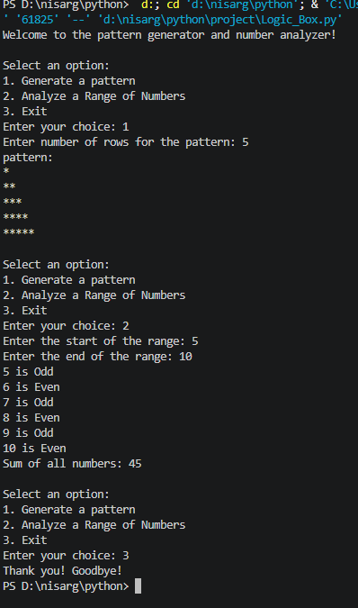

# Pattern Generator and Number Analyzer

A simple Python project that generates a star pattern and analyzes a range of numbers using `match-case`.

## Features

- Generate a star pattern based on the number of rows entered.
- Identify each number in a range as even or odd.
- Calculate the sum of all numbers in the selected range.
- Exit the program from the menu.

## Requirements

- Python 3.10 or newer (`match-case` is supported from Python 3.10).

## How to Run

1. Save the Python code in a file named `pattern_analyzer.py`.
2. Open a terminal or command prompt in that folder.
3. Run:

```bash
python pattern_analyzer.py
```

## Menu Options

1. **Generate a pattern** — enter the number of rows to print a growing triangle of stars.
2. **Analyze a range of numbers** — enter the start and end values to see whether each number is even or odd, along with the total sum.
3. **Exit** — close the program.

## Example Output

### Option 1: Generate a Pattern

```text
Enter your choice: 1
Enter number of rows for the pattern: 5
pattern:
*
**
***
****
*****
```

### Option 2: Analyze a Range of Numbers

```text
Enter your choice: 2
Enter the start of the range: 1
Enter the end of the range: 5
1 is Odd
2 is Even
3 is Odd
4 is Even
5 is Odd
Sum of all numbers: 15
```

### Option 3: Exit

```text
Enter your choice: 3
Thank you! Goodbye!
```

## Concepts Used

- `while` loop for repeatedly displaying the menu.
- `match-case` for handling the user's choice.
- `for` loops for generating the pattern and checking numbers.
- `if-else` for identifying even and odd numbers.
- `break` to exit the program.

## Output Screenshot

Add your project screenshot below. Save the screenshot in the same folder as this README file and name it `output.png`.

```markdown

```
